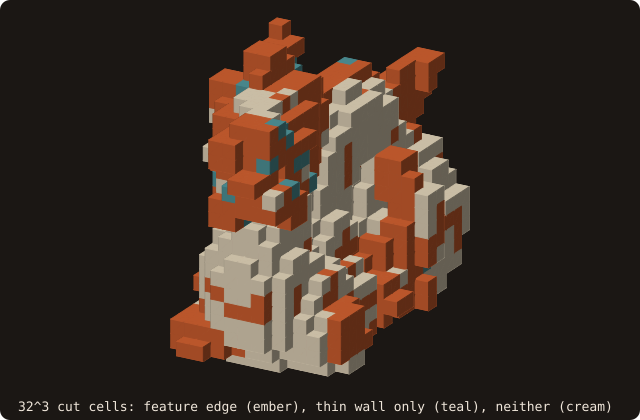

# 9. AMR tagging

An adaptive grid decides where to refine before any field exists. FOSSIL answers the tagging questions from the BVH
alone: does a box meet the wall, does the wall come near it, and if neither, is it inside or outside. This chapter
classifies one level of blocks around the placed dragon of chapters 2–3, builds an octree from the same call, tags the
cells of a block by their distance to the wall, does the same on the section of chapter 7, and adds two more fields:
the cells near a sharp edge and the cells near a wall thinner than a cell.

## Classifying blocks

The domain [−0.6, 0.6]³ is cut into 8³ blocks of side 0.15. One batch call classifies them all.

<<< @/examples/snippets/tut09_a_blocks-classify.f90

- `box_classify_many(lo=, hi=, codes=)` classifies n boxes given their corners `lo(3, n)` and `hi(3, n)`:
  - `BOX_CUT`: the box meets the surface, by a separating-axis test against each candidate triangle, run on the box
    inflated by 1e-12 of the problem size. The test never misses a contact; a box closer than that may count as cut.
  - `BOX_NEAR` (only with `radius=` > 0): not cut, but a triangle comes within `radius` of the box.
  - `BOX_INSIDE` / `BOX_OUTSIDE`: neither; one point query at the box centre decides the side.
- The centre query uses `sign_algorithm=`, whose default here is `SIGN_FAST_WINDING_NUMBER`, not the pseudo-normal of
  the point queries. `inside(n)` optionally returns the centre side of every box that is not cut, near boxes included.

<<< @/examples/snippets/tut09_a_blocks-one.f90

- `box_intersects_surface(lo, hi)` answers for one box, with the same test. Here the first cut block meets the dragon
  and its lower half does not.

<<< @/examples/output/tut09a.ansi{ansi}

- 87 of the 512 blocks meet the dragon. With `radius=0.05`, 62 of the 425 uncut blocks become near; the cut count does
  not change. No block of side 0.15 fits inside the thin dragon, so none is inside.

{.fossil-figure}

## Refining level by level

An octree is the same call applied level by level: classify every box of a level in one batch, split the boxes that
must be refined into eight children, and keep the others as leaves.

<<< @/examples/snippets/tut09_b_octree-tree.f90

- A box is refined when it is `BOX_CUT`, or `BOX_NEAR` within the diagonal of its children, `radius` = side·√3/2:
  where the level set may be smaller than the next level's cells (the criterion of Matsushita & Aoki 2021), decided
  before any level set exists.
- Inside and outside boxes become leaves at once: the wall does not come near them, so nothing finer is needed there.

<<< @/examples/output/tut09b.ansi{ansi}

- Every box of levels 0 and 1 is cut. From level 2 on, the outside boxes drop out; the near ring is wider than the cut
  ring at every level, because the radius is the children's diagonal and not the box's.
- The first inside boxes appear at level 5, side 0.0375: 13 of them. Coarser boxes do not fit in the dragon.
- Six levels end with 9094 leaves against 32768 cells of the uniform grid of the finest side. The 1689 cut boxes of
  level 5 are the cells of a uniform 32³ grid that meet the dragon, the count the next section finds cell by cell.

{.fossil-figure}

## Tag bands on a block

A solver that refines block by block needs more than cut or not: how far each cell is from the wall, in cells. One
block of 32³ cells over the whole domain:

<<< @/examples/snippets/tut09_c_tags-tags.f90

- `tag_block(x=, y=, z=, band=, tags=)` takes the cell edges of a rectilinear block (stretched allowed) and returns
  one tag per cell: 0 on a cut cell, otherwise the Chebyshev cell distance to the nearest cut cell, capped at
  `band + 1`, negative inside and positive outside. `band = 4` gives the cut, neighbour, extension and
  reinitialisation rings an IB solver tags.
- Each connected group of uncut cells is signed by one point query, with the same default sign algorithm.
- The block sees only itself: a cut cell in a neighbouring block does not count, so a band that must cross block
  faces needs the block padded with ghost cells.

{.fossil-figure}

The tags are in the first line of the run below: 1689 cut cells, the count of the octree's finest level. Inside, no
cell is more than 2 cells from a cut cell (7 cells at −2): the dragon is at most a few cells thick at this spacing.
Outside, the 19531 cells beyond the band of 4 get the cap, +5. A cell of the layer is cut if the wall crosses it
anywhere in its height, so the cream ring follows the wall over the whole layer, not only the yellow section at its
mid-plane.

## The section in 2-D

The 2-D twin works on a `curve_object`: the same calls without the z coordinates. Here the dragon is cut at the
mid-plane of layer 16 and the section tagged on the same 32 × 32 cells.

<<< @/examples/snippets/tut09_c_tags-twin.f90

- `curve_object%tag_block(x=, y=, band=, tags=)` is the 2-D twin, with 8-connected components; the cut test is exact
  (`orient2d` on the curve's own vertices). `box_classify_many` and `box_intersects_curve` are the twins of the block
  calls above, with `lo(2, n)` and `hi(2, n)`.

<<< @/examples/output/tut09c.ansi{ansi}

- On its mid-plane the layer has 58 cut cells, against 80 for the layer in 3-D, and every cell the section cuts is cut
  in the layer: the 3-D tags see the wall over the cell's height, the 2-D tags only in the plane.
- The section's inside is thinner still: 22 cells at −1 and none deeper.

{.fossil-figure}

## Feature edges and thin walls

Two parts of a body need cells finer than the rest of the wall: sharp edges, where the level set has a kink, and walls
or gaps thinner than a cell, where it cannot resolve both sides. `tag_block` gives one more tag field for each, on
the same block.

<<< @/examples/snippets/tut09_d_features-fields.f90

- `build_features(angle=)` stores the feature edges (creases sharper than `angle`, default 30°; boundary and
  non-manifold edges) in a tree of their own. Then `feature_band=` and `feature_tags=` give the Chebyshev cell
  distance to the nearest cell a feature edge touches, capped at `feature_band + 1`. On the scanned dragon most of the wall
  has creases sharper than 30°; 60° keeps the strongest, on the horns, the claws and the tail.
- `thickness(thickness=, gap=)` measures each facet ([thickness and gaps](/guide/advanced/thickness)),
  `build_thin` stores the local size min(thickness, gap). Then `thin_factor=`, `thin_band=` and `thin_tags=` give the
  cell distance to the nearest cell that meets a facet thinner than `thin_factor` times the cell's largest side.
- Both stores are explicit, because the queries take the surface `intent(in)`; `analyze` drops them.

<<< @/examples/output/tut09d.ansi{ansi}

- 2465 of the 6586 facets are thinner than a cell side, 0.0375.
- Of the 1689 cut cells, 867 hold a feature edge, 56 more meet a thin wall, and 766 are neither: refining on the
  three fields together puts the finest cells on half the wall.

{.fossil-figure}

::: tip What you learned
`box_classify_many` sorts boxes into cut, near, inside and outside from the tree alone, and builds an octree one level
per batch; `tag_block` gives signed distance-to-cut bands on a block of cells, in 3-D and on a curve, plus feature and
thin-wall fields after `build_features` and `build_thin`. Reference: [AMR tagging](/guide/advanced/amr-tagging),
[feature edges](/guide/advanced/feature-edges#refinement-along-the-features),
[thickness and gaps](/guide/advanced/thickness#amr-criterion). The device batch, `box_classify_many_device`, is in
[chapter 16](./16-gpu).
:::

Next: [10. Cut cells](./10-cut-cells).
