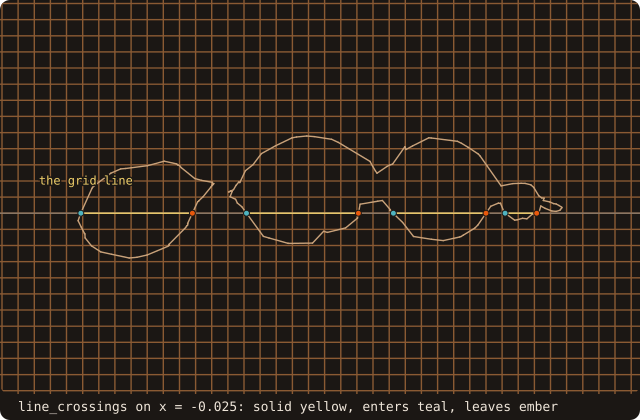
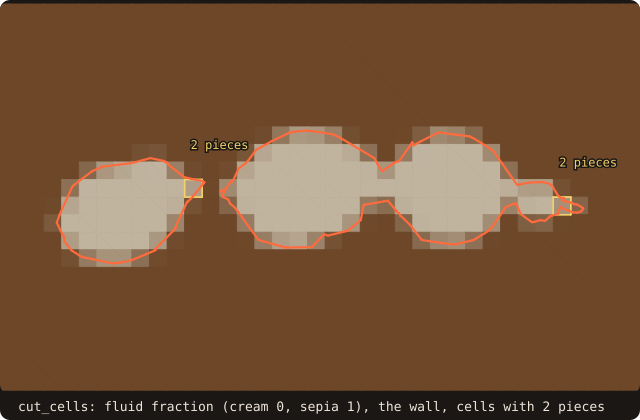
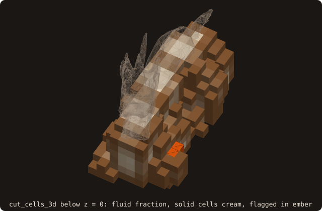

# 10. Cut cells

A conservative cut-cell solver needs, for every cell the wall crosses, the fluid fraction of the cell, the fluid
fraction of each face, and the separate fluid pieces when the wall splits a cell. Before its first step it also needs
which piece talks to which, where a small piece sends its state, and integrals of higher order than the centroid.
FOSSIL computes all of it exactly from the geometry. This chapter builds it up in five short runs: one grid line, the
2-D cut cells of the section of chapter 7, the 3-D cut cells of the dragon, then the solver support on top of them.

## Crossings of a grid line

Every cut-cell quantity starts from where the wall crosses the grid lines. Take the 48 × 48 block of cells of side
0.025 around the section and find the grid line with the most crossings.

<<< @/examples/snippets/tut10_a_crossings-line.f90

- `line_crossings(axis=, a=, t0=, t1=, t=, segments=, entering=, n=)` returns the crossings of one axis-aligned line
  with the curve: `axis=1` is the line along u at v = a, `axis=2` the line along v at u = a (for this section, normal
  to z, u = x and v = y). The parameters `t` in [t0, t1] are sorted, each with its segment and whether the line,
  travelling in +axis, enters the solid there.
- The side of a vertex against the line is decided by the exact `orient2d`, with a symbolic tie-break when a vertex
  lies on the line: each crossing is counted once, so the entering and leaving flags alternate on a closed curve.
  The positions are rounded, the topology is not.

<<< @/examples/output/tut10a.ansi{ansi}

The line x = −0.025 crosses the section 8 times, entering and leaving in turn. Between an
entering crossing and the next leaving one the line is in the solid, 0.538856 of its length in all.

{.fossil-figure}

## Cut cells of a section

The crossings of all the grid lines, walked cell by cell, give the cut cells.

<<< @/examples/snippets/tut10_b_cells2d-cells.f90

- `cut_cells(x=, y=, cut=)` takes the cell edges of a block, strictly increasing in each direction, and fills a
  `cut_cells_2d_t`. The fluid is outside the solid. Per cell (nx × ny arrays): `alpha`, the fluid area fraction, 1 in
  the fluid and 0 in the solid; `aperture(4, :, :)`, the fluid fraction of the four edges in the order −x, +x, −y,
  +y; `centroid`, `wet_length`, `wet_centroid` and `wet_normal`, the fluid centroid and the wetted wall.
- A cell whose boundary does not close (an open loop) is flagged in `closed`, with `alpha = -1`.

<<< @/examples/snippets/tut10_b_cells2d-apertures.f90

<<< @/examples/output/tut10b.ansi{ansi}

- 91 of the 2304 cells are cut. The solid area summed from the fractions equals the area of the curve to the printed
  digits, 0.0726092.
- The −x edges of column 24 lie on the grid line of the first run: their solid parts add up to 0.538856, the solid
  length that `line_crossings` gave. The apertures are the crossings of the grid lines, read edge by edge.
- In the cell with the longest wall, (23, 41), the normal integral of the wall, pointing into the fluid, is
  (0.2371, 0.4930) h: the differences of the opposite apertures, +x minus −x and +y minus −y. The fluid region of the
  cell is closed, so its boundary normals cancel. A finite-volume update that uses the apertures and `wet_normal`
  keeps a uniform flow uniform.

{.fossil-figure}

## Fluid pieces

Where two walls cross the same cell, its fluid can come in parts that do not touch. A solver must keep their states
apart: one fraction per cell would let mass leak across the solid between them.

<<< @/examples/snippets/tut10_b_cells2d-pieces.f90

- `pieces(i, j)` is the number of fluid pieces of a cell, numbered from `first_piece(i, j)` in the block-wide piece
  arrays: `piece_cell`, `piece_area`, `piece_centroid`, `piece_wet_length`, `piece_wet_normal` and
  `piece_aperture(4, :)`. A cell with one piece is that piece; the block has `np` pieces in all.
- `piece_iv_start`, `piece_iv_edge`, `piece_iv_lo` and `piece_iv_hi` list the fluid intervals each piece owns on the
  cell edges. Two pieces of one cell share no interval, so their apertures add up to the cell's.

The last lines of the run above: of the 2234 pieces, two cells hold two. In cell (22, 20), between the first two lobes of
the section, the pieces are 0.1891 and 0.0171 of the cell, and they own disjoint edges: the large one +x and +y, the small
one −x and a 0.0785 sliver of +y. Their fractions add up to the cell's 0.2061.

{.fossil-figure}

## Cut cells in 3-D

The same quantities in 3-D: volume fractions, the six face fractions, the wetted area and the pieces.

<<< @/examples/snippets/tut10_c_cells3d-cells.f90

<<< @/examples/snippets/tut10_c_cells3d-pieces.f90

- `cut_cells_3d(surface=, x=, y=, z=, cut=)` is a free routine (from `use fossil`) that fills a `cut_cells_3d_t`:
  `alpha`, `face_x`, `face_y`, `face_z` (the fluid fraction of every grid face), `wet_area`, `wet_centroid`,
  `wet_normal`, and the pieces: `pieces(i, j, k)` from `first_piece(i, j, k)`, each with `piece_volume`,
  `piece_centroid`, its wall terms and `piece_face(6, :)`, its fluid fraction of the six faces (−x, +x, −y, +y, −z,
  +z).
- `pieces = -1` flags a cell that cannot be trusted: a boundary edge of the mesh crosses it, or its faces do not
  close. Such a cell has no measures and `alpha = -1`.

<<< @/examples/output/tut10c.ansi{ansi}

- 895 of the 13824 cells are cut; 17 are flagged. The dragon is open (chapter 2), and the cells its open edges cross
  get no measures: a solid with holes has no inside to measure there.
- 75 cells have two or more pieces. In cell (13, 7, 6) the fluid is 6.856 % of the cell, in two pieces of 6.533 % and
  0.323 %. Their face fractions add up to the cell's: on −x, 0.046 and 0.008 make 0.055 within the rounding of the
  print, on −z 0.866 and 0.102 make 0.967.

{.fossil-figure}

The top of the cubes is the plane z = 0 of the 2-D section: the solid inside, the cut cells around it. The ember
cells are flagged, where an open edge of the dragon crosses them.

## A plane through the block

A face of a 3-D cell lies in a grid plane, and its fluid fraction is a 2-D cut cell of the section of the body by that
plane. The plane z = 0 is the grid plane `x(13)`, and chapter 7 saved its section.

<<< @/examples/snippets/tut10_c_cells3d-faces.f90

The 43 cut faces of that plane equal the 2-D fractions of the section on the same grid to 3.47e-15 (second line of
the run above): two different code paths, one from the triangles and one from the saved curve, agree to round-off.
The animation sweeps the block layer by layer: each frame shows the cells between two grid planes, shaded by their
volume fraction, with the section at the bottom plane of the layer in teal and at its top plane in red. The cut cells follow the
two sections (a cell is also cut by a part of the body that ends between the two planes); the 17 flagged cells sit in
five layers, where the open edges of the dragon lie.

![the block of 24 by 24 by 24 cells swept from z = -0.40 to z = 0.40, one layer of cells per frame seen from above: the cells of the layer shaded by their fluid fraction, the flagged ones in ember, the dragon's section at the layer's bottom plane in teal and at its top plane in red; the caption counts the cut and flagged cells of each layer, 107 cut and 5 flagged in the layer z in [-0.35, -0.30]](../../examples/images/anim-tut10-sweep.svg){.fossil-figure}

## Links, neighbourhoods and merge targets

Explicit schemes on cut cells are limited by the smallest piece: a piece of 4e-4 of its cell would force a time step
about 2500 times shorter. The cures (state redistribution, flux redistribution, cell merging) all work on the graph of the
pieces. FOSSIL builds the graph and the neighbourhoods; the solver keeps the arithmetic on its states.

<<< @/examples/snippets/tut10_d_solver-links.f90

- `cut_links_2d(cut, links)` gives a `cut_links_t` in CSR form: the links of piece p are `start(p)` to
  `start(p + 1) - 1`, each with the `piece` across, the `face` (1 to 4: −x, +x, −y, +y) and the shared fluid `area`
  (a length in 2-D). Both directions are stored, with the same area.
- Two pieces are linked only where they share a fluid interval of a cell edge, never across the solid.

<<< @/examples/snippets/tut10_d_solver-srd.f90

- `srd_neighbourhoods(links, piece_cell, piece_volume, piece_centroid, wet_normal, x, y, srd)` marks a piece small
  if it holds less than τ = ½ of its cell and grows its neighbourhood through the links, the neighbours along the
  wall normal first, until it holds τ of a cell. `srd%start`/`srd%member` list it, the piece first; `vhat`, `xhat`,
  `eta_nb` and `eta_self` are the weighted volumes, centroids and factors of weighted state redistribution.

<<< @/examples/snippets/tut10_d_solver-merge.f90

- `merge_targets(links, piece_cell, piece_volume, wet_normal, x, y, mt)` gives each small piece one target, the
  linked piece that is not small and lies best along the wall normal (`target`, `final_target` after a chain through
  small pieces), and the normal-directed targets of conservative mixing (`mix_piece`, `mix_weight`).

<<< @/examples/snippets/tut10_d_solver-links3d.f90

- In 3-D the links come with the cut cells, `cut_cells_3d(..., links=)`: the pieces across a face are matched through
  the fluid regions of the face. `links%unmatched` counts the regions it could not assign.

<<< @/examples/output/tut10d.ansi{ansi}

- The small piece of cell (22, 20) links to two pieces: across −x over 0.4351 h and across +y over 0.0785 h, its
  two apertures of the previous run. It does not link to the other piece of its own cell.
- 47 pieces are small; every neighbourhood reaches τ (none is incomplete). The smallest, 4.07e-4
  of cell (24, 28), needs one neighbour: with the piece of cell (25, 28) across its wall normal the neighbourhood holds
  0.8991 of a cell.
- All 47 have a suitable target directly; the smallest one's is that same cell (25, 28), and it has 2
  normal-directed targets.
- The 3-D graph of the dragon: 78614 links over 13797 pieces, no unmatched region.

{.fossil-figure}

## Moments, quadrature and a coarse level

A second-order scheme needs the centroid of each piece; a higher-order one needs integrals of polynomials over it, and
an AMR solver needs the same geometry on the coarse level.

<<< @/examples/snippets/tut10_e_moments-moments.f90

- `cut_cells(..., moments_order=p)` (p ≤ 4; `cut_cells_3d(..., moments_order=)` in 3-D) gives `piece_moments(:, np)`,
  the integrals of X^a Y^b over each piece with a + b ≤ p, in X = (x − x_c)/h, Y = (y − y_c)/h about the cell centre,
  in the order of `mono_exponents`: 1, X, Y, X², XY, Y². `piece_wall_moments` are the same over its wall.

<<< @/examples/snippets/tut10_e_moments-quadrature.f90

- `quadrature=.true.` adds a rule per piece: `quad_start`, `quad_point`, `quad_weight` for the area and
  `wall_quad_start`, `wall_quad_point`, `wall_quad_weight` for the wall. The area rule is a fan of signed triangles
  from the cell centre over the piece's oriented boundary (`boundaries=.true.` exports it: `piece_seg_start`,
  `piece_seg`), 7 points each, exact to degree 5. Where the piece is not star-shaped about the centre, triangles
  over the solid side carry negative weights that cancel the points outside the piece.

<<< @/examples/snippets/tut10_e_moments-coarsen.f90

- `cut_coarsen_2d(fine, links, x, y, ratio, coarse, coarse_links, fine_to_coarse, status)` (`cut_coarsen_3d` in 3-D)
  builds the coarse level from the fine one: coarse pieces are the fine pieces of a coarse cell joined by fine links,
  and their measures, moments and links are sums of the fine ones.

<<< @/examples/output/tut10e.ansi{ansi}

- The first piece of the tail cell (23, 41) holds 0.21077 of the cell. Its first moments divided by its area give
  its centroid, (−0.02893, 0.41522), the same as `piece_centroid`.
- Its rule has 42 area points, 21 of them with negative weights, and 12 wall points. The weights add up to the area
  to 3.25e-19 and the rule integrates X² to the moment to 4.74e-20.
- At ratio 2 the 2234 fine pieces become 570 coarse ones, as many as the cut cells computed directly on the coarse
  grid, and the coarse fractions equal the direct ones to 1.78e-15.

{.fossil-figure}

::: tip What you learned
`line_crossings` gives the exact crossings of a grid line; `curve%cut_cells` and `cut_cells_3d` give exact fluid
fractions, apertures, face fractions and fluid pieces, and flag the cells an open surface makes untrustworthy.
`cut_links_2d` (or `links=`), `srd_neighbourhoods` and `merge_targets` give the piece graph a small-cell cure works
on, `moments_order=` and `quadrature=` the higher-order geometry, `cut_coarsen_2d`/`cut_coarsen_3d` the coarse
level. Reference: [Cut-cell geometry](/guide/advanced/cut-cells), [Cut cells: solver
support](/guide/advanced/cut-solver).
:::

Next: [11. Moving bodies](./11-moving-bodies).
