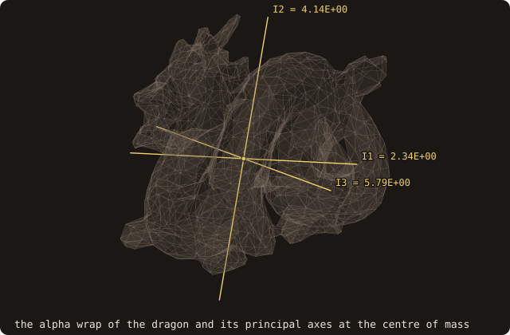
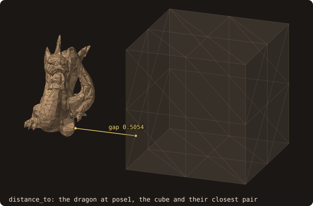

# 11. Moving bodies

The dragon now moves. Over one time step it pitches by 10 degrees about y and moves 0.02 along x. A solver that
rebuilds the search tree at every step pays for a full build each time, and that cost is what this chapter avoids.
FOSSIL queries the body in its own frame, or moves a copy and refits its tree. It also computes what a moving
cut-cell update needs: the cells that change state, the geometry the wall sweeps in a step, the body's inertia and the
gap to another body. The chapter takes these one step at a time, one short program per step, all reading the
placed dragon of chapters 2 and 3.

<<< @/examples/snippets/tut11_1_posed-pose.f90

- A `rigid_pose_t` holds a rotation `r(3, 3)` and a translation `t(3)`, with x_world = R x_body + t.
  `pose_identity()` is the rest pose. `pose_from_axis_angle(axis=, angle=, translation=)` builds a pose from an axis,
  an angle in radians and a translation (default 0). `pose_from_quaternion`, `pose_compose`, `pose_inverse` and
  `pose_interpolate` (the screw motion between two poses) complete the algebra.
- The 24³ cell centres span the cube [-0.6, 0.6]³, which holds the placed dragon. Every step below uses the same grid
  and the same step.

## Querying the body at a pose

A query at a pose can be answered in two ways. One maps the points into the body frame and leaves the body alone.
The other moves the body.

<<< @/examples/snippets/tut11_1_posed-queries.f90

- `pose=` on `query_many` (also on `distance_many`, `is_point_inside` and the device batches) maps each world point
  into the body frame, x̃ = Rᵀ (x − t), and queries the tree as built: one 3 × 3 product per point. The outputs
  (closest points, normals) come back in the world frame.
- `move(pose)` moves the facets of a copy and refits its BVH: node boxes recomputed bottom-up, topology kept, O(N)
  instead of a rebuild. Queries aligned with the grid (box tagging, line crossings, cut cells) work on the facets
  themselves and need the moved copy.

<<< @/examples/output/tut11-posed.ansi{ansi}

The two ways agree to round-off: 2.2e-16 on the distances, 2.8e-15 on the closest points. At the new pose, 441 of the
13824 centres lie inside the dragon.

{.fossil-figure}

## Cells that change state

A cut-cell solver must initialize the cells that the wall uncovers during the step (fresh: solid to fluid) and
retire the ones it covers (dead: fluid to solid).

<<< @/examples/snippets/tut11_2_state-state.f90

- `state_changes(pose0=, pose1=, points=, fresh=, dead=)` flags the points whose side changes between two poses.
- A point farther from the wall than the wall moves during the step cannot change state, so the routine skips its
  second query. `checked` counts the points that needed that query. The sign algorithm defaults to the
  pseudo-normal, as for the point queries.

<<< @/examples/output/tut11-state.ansi{ansi}

The step makes 96 cells fresh and 98 dead. Only 992 of the 13824 centres needed the second query, about 7 %. The
figure shows the plane of centres y = −0.125, which has the most changes (9 fresh, 10 dead). The fresh cells lie
where the wall left and the dead ones where it arrived.

{.fossil-figure}

Over many steps, the fresh and dead cells form two fronts that travel with the body. The animation moves a decimated
copy of the dragon through a plane of cells along a path from `pose_interpolate`, and calls `state_changes` between
consecutive poses.

{.fossil-figure}

## Swept geometry of a translation

A conservative cut-cell update needs, per cell, the change of its fluid volume over the step, and per face, the fluid
aperture averaged over the step. The first test case is the section of chapter 7 translated by 0.02 along x, 0.8 of a
cell.

<<< @/examples/snippets/tut11_3_swept-translation.f90

- `swept_cells_2d(curve, pose0, pose1, x, y, sw)` (and `swept_cells_3d(surface, pose0, pose1, x, y, z, sw)`) are free
  routines with the swept geometry of a step on a fixed grid. A `rigid_pose_2d_t` comes from `pose_2d(angle=,
  translation=)`.
  - `sw%swept` is the change of fluid area of each cell, (α₁ − α₀)|cell|, from the exact cut cells at the two poses.
  - `sw%face_u` and `sw%face_v` are the fluid lengths of the faces averaged over the step. `sw%wall` is the averaged
    projected wall.
  - `sw%cleared` and `sw%covered` flag the cells with no fluid at one pose and fluid at the other.
  - `sw%residual` is the volume balance of the rigid velocity field in each cell. It is round-off when the face
    averages are exact and the wall does not cross itself.
- A pure translation takes the exact path (`sw%exact`). The face lengths are piecewise linear in time, and they are
  integrated between the instants when a vertex crosses a grid line or a node crosses a segment.

<<< @/examples/snippets/tut11_3_swept-knot.f90

<<< @/examples/output/tut11-swept.ansi{ansi}

- The step sweeps 131 cells. 16 of them are cleared (no fluid before, fluid after) and 16 are covered. The swept
  areas sum to −9.7e-18, since a rigid translation keeps the area.
- The residual is round-off in every cell but two, and reaches 5.3e-6 in cell (23, 22). That cell holds the knot of
  [chapter 7](./07-curves), where the section crosses itself once. The swept areas come from the cut cells (Green's
  theorem, which counts a region by its winding number), the face averages from line crossings (parity), and the two
  count the knot differently. The residual is where they disagree.
- `check_input=.true.` checks the curve first: `sw%self_intersecting`, and a warning on stderr. You can also call
  `check_validity(check_self_intersections=.true.)` once, before the time loop.

{.fossil-figure}

## Swept geometry of a rotation

A rotation is the general case: a wall vertex moves along a circular arc, and a face's fluid length is no longer
piecewise linear in time. The test case is a section of the placed dragon that does not cross itself (z = −0.05),
turned by 10 degrees about the origin. Then comes a 3-D body, the unit cube turned by 15 degrees about its vertical
axis.

<<< @/examples/snippets/tut11_4_rotation-rotation.f90

<<< @/examples/snippets/tut11_4_rotation-solid.f90

- A rotation takes the exact path too (`exact=.true.` is the default). For each face, the routine finds the instants
  when the combinatorics change (a vertex on the face's line, a node on a segment) as certified zeros of a function
  of time. Between them it applies Gauss-Legendre, doubling the nodes until the result stops changing at round-off.
  `sw%evaluations` is the largest number of evaluations one face needed.
- `swept_cells_3d` does the same per grid plane: a mesh vertex on the moving plane, a mesh edge on a grid line, a grid
  node on a triangle.
- `exact=.false.` falls back to `nq` fixed Gauss nodes (default 4), and `sw%error_estimate` compares them with 2 nq.

<<< @/examples/output/tut11-rotation.ansi{ansi}

The section has 135 segments and no crossing pair, so both paths are exact. Turning it by 10 degrees sweeps 164 cells,
and one face needed at most 106 evaluations. The swept areas sum to 1.0e-18 and the largest residual is 1.2e-17. The
cube turned by 15 degrees sweeps 327 cells and clears 27, with the swept volumes summing to 1.4e-16 and the largest
residual 4.7e-17.

{.fossil-figure}

## Mass and inertia

A body moved by the fluid, rather than along prescribed poses, needs its mass properties to integrate the
Newton–Euler equations.

<<< @/examples/snippets/tut11_5_inertia-inertia.f90

- `mass_properties(mass=, volume=, center=, inertia=, principal_moments=, principal_axes=, density=, about=,
  status=)` gives the mass, the centre of mass, the inertia tensor about the centre (or about `about`) and its
  principal moments (ascending) and axes. The integrals are exact; see
  [mass properties](/guide/advanced/mass-properties).
- It needs a closed body, and the repaired dragon is not one (chapter 2), so the call returns a status other than
  `STATUS_OK`. Its alpha wrap is closed by construction and serves as the surrogate. It is offset 0.006 outside the
  surface, and a coarser `alpha` makes it fatter, so the inertia is the wrap's.

<<< @/examples/snippets/tut11_5_inertia-world.f90

- `inertia_to_world(inertia, pose)` gives the tensor at a pose, R I Rᵀ, without moving anything.

<<< @/examples/output/tut11-inertia.ansi{ansi}

The wrap has 2128 facets and is watertight. At density 1000 its mass is 68.96, its centre of mass is
(−0.0192, −0.0337, −0.0958), and its principal moments are 2.34, 4.14 and 5.79. The moved wrap's tensor equals
`inertia_to_world` to 3.1e-16 relative.

{.fossil-figure}

## Distance between bodies

Two bodies in the same flow need the gap between them: for contact, for a lubrication correction when the gap falls
to a few cells, and for collision.

<<< @/examples/snippets/tut11_6_gap-gap.f90

- `distance_to(other, distance=, point_self=, point_other=, facet_self=, facet_other=, intersecting=)` is the least
  distance over all pairs of facets of the two bodies, with the pair that realizes it. It returns 0 and `intersecting`
  when the bodies touch or cross, decided exactly. The two trees are descended together, best first, and the result is
  bit-identical to a loop over all pairs.
- `pose_self=` and `pose_other=` place the bodies where `move` would put them, using the trees as built.

<<< @/examples/snippets/tut11_6_gap-moved.f90

<<< @/examples/output/tut11-gap.ansi{ansi}

The gap is 0.50539, between facet 1077 of the dragon and facet 48 of the cube. The posed call and the moved copy give
the same gap bit for bit. `proximity_pairs(cutoff=)` lists the pairs of bodies closer than a cutoff, and
[chapter 14](./14-contact) follows two bodies to the instant they touch. See
[body–body distance](/guide/advanced/body-distance).

{.fossil-figure}

::: tip What you learned
`pose=` queries a moving body without touching its tree. `move` refits a copy for the queries aligned with the grid.
`state_changes` finds fresh and dead cells. `swept_cells_2d` and `swept_cells_3d` give the exact swept geometry of a
translation or a rotation. `mass_properties` and `inertia_to_world` give the inertia, and `distance_to` gives the gap
between two bodies. Reference: [Moving bodies](/guide/advanced/moving-bodies),
[Body–body distance](/guide/advanced/body-distance).
:::

Next: [12. Geometry processing and analysis](./12-geometry).
