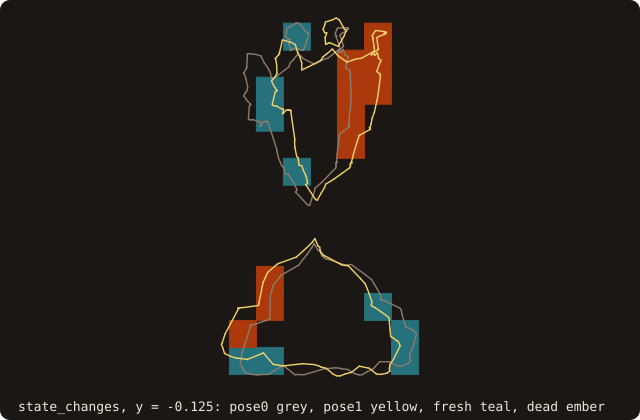
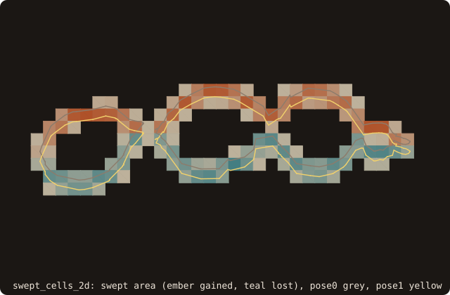

# 11. Moving bodies

The dragon now moves: over one time step it pitches by 10 degrees about y and moves 0.02 along x. Rebuilding the tree
at every step is the cost to avoid. FOSSIL either queries the body in its own frame or moves a copy and refits its
tree, and it gives what a moving cut-cell update needs: the cells that change state and the swept geometry.

<<< @/examples/snippets/tut11_moving_bodies-pose.f90

- A `rigid_pose_t` holds a rotation `r(3, 3)` and a translation `t(3)`, with x_world = R x_body + t.
  `pose_identity()` is the rest pose, `pose_from_axis_angle(axis=, angle=, translation=)` builds one from an axis, an
  angle in radians and a translation (default 0); `pose_from_quaternion`, `pose_compose` and `pose_inverse` are the
  rest of the algebra.

<<< @/examples/snippets/tut11_moving_bodies-queries.f90

- `pose=` on `distance_many` (also on `query_many`, `is_point_inside` and the device batches) maps the world points
  into the body frame, x̃ = Rᵀ (x − t), and queries the tree as built: one 3 × 3 product per point.
- `move(pose)` moves the facets of a copy and refits its BVH: node boxes recomputed bottom-up, topology kept, O(N)
  instead of a rebuild. Grid-aligned queries (box tagging, line crossings, cut cells) need the moved copy.
- `state_changes(pose0=, pose1=, points=, fresh=, dead=)` flags the points that go from solid to fluid (`fresh`) and
  from fluid to solid (`dead`) between two poses. A point farther from the wall than it moves cannot change state, so
  its second query is skipped; `checked` counts those that needed it. The sign algorithm defaults to the
  pseudo-normal, as for the point queries.

{.fossil-figure}

{.fossil-figure}

<<< @/examples/snippets/tut11_moving_bodies-swept.f90

- `swept_cells_2d(curve, pose0, pose1, x, y, sw)` (and `swept_cells_3d(surface, pose0, pose1, x, y, z, sw)`) are free
  routines with the swept geometry of a step on a fixed grid. A `rigid_pose_2d_t` comes from `pose_2d(angle=,
  translation=)`.
  - `sw%swept` is the fluid area change of each cell, (α₁ − α₀)|cell|, from the cut cells at the two poses.
  - `sw%face_u`, `sw%face_v` are the fluid lengths of the faces averaged over the step; `sw%wall` is the averaged
    projected wall.
  - `sw%cleared` and `sw%covered` flag cells with no fluid at one pose and fluid at the other.
  - `sw%residual` is the volume balance of the rigid velocity field in each cell: round-off when the face averages
    are exact and the wall does not cross itself.
- A pure translation takes the exact path (`sw%exact`): the face lengths are integrated piecewise between the
  instants when a vertex crosses a grid line or a node crosses a segment. A rotation is integrated by Gauss-Legendre
  at `nq` nodes (default 4), with `sw%error_estimate`.

{.fossil-figure}

## Mass and inertia

A body moved by the fluid, not along prescribed poses, needs its mass properties to integrate Newton–Euler.

<<< @/examples/snippets/tut11_moving_bodies-inertia.f90

- `mass_properties(mass=, center=, inertia=, principal_moments=, principal_axes=, density=, about=, status=)` gives the
  mass, the centre of mass, the inertia tensor about the centre (or about `about`) and its principal moments and axes.
  The integrals are exact; see [mass properties](/guide/advanced/mass-properties).
- It needs a closed body, and the repaired dragon is not one (chapter 2). Its alpha wrap is closed by construction, a
  surrogate 0.003 outside the surface, so the inertia is the wrap's.
- `inertia_to_world(inertia, pose)` is the tensor at a pose, R I Rᵀ: the moved wrap gives the same tensor to round-off.

{.fossil-figure}

The animation integrates Euler's equations with the inertia tensor `mass_properties` returns for a T-handle: a spin
about the intermediate principal axis is unstable, and the handle flips over periodically (the tennis-racket effect).

## Distance between bodies

Two bodies in the same flow need the gap between them: for contact, for a lubrication correction when it falls to a
few cells, for a collision.

<<< @/examples/snippets/tut11_moving_bodies-gap.f90

- `distance_to(other, distance=, point_self=, point_other=, facet_self=, facet_other=, intersecting=)` is the least
  distance over all pairs of facets of the two bodies, with the pair that realizes it; 0 and `intersecting` when they
  touch or cross, decided exactly. The two trees are descended together, best first, and the result is bit-identical
  to the loop over all pairs.
- `pose_self=` and `pose_other=` take the bodies where `move` would put them, with the trees as built: the result
  equals the one of the moved copy, bit for bit. `proximity_pairs(cutoff=)` lists the pairs of bodies closer than
  a cutoff. See [body–body distance](/guide/advanced/body-distance).

{.fossil-figure}

## Running it

<<< @/examples/output/tut11.ansi{ansi}

- The body-frame distances equal those of the moved and refitted copy to 1e-14.
- The gap to the cube with `pose_self=` equals the gap of the moved copy bit for bit.
- Of the 13824 cell centres, 96 become fluid and 98 become solid; only 992 needed the second query.
- The section translated by 0.02 sweeps 131 cells, 16 of which go from solid to fluid. The swept areas sum to zero,
  as a rigid translation keeps the area.
- The residual is round-off in every cell but two, and 5.3e-6 in cell (23, 22). That is the knot of
  [chapter 7](./07-curves): the section crosses itself once, at a fold. The swept areas come from the cut cells
  (Green's theorem, a region counted by its winding number) and the face averages from line crossings (parity),
  which count the knot differently; the residual is where they disagree. With the knot cut out of the section the
  largest residual over the same kind of shifts is 7.8e-18. Pass `check_input=.true.` to have `swept_cells_2d` check
  the curve first (`sw%self_intersecting`, a warning on stderr), or check it with
  `check_validity(check_self_intersections=.true.)`.

::: tip What you learned
`pose=` queries a moving body without touching its tree, `move` refits a copy for grid-aligned queries,
`state_changes` finds fresh and dead cells, `swept_cells_2d`/`swept_cells_3d` give the swept geometry of a step, and
`distance_to` the gap between two bodies. Reference: [Moving bodies](/guide/advanced/moving-bodies),
[Body–body distance](/guide/advanced/body-distance).
:::

Next: [12. Geometry processing and analysis](./12-geometry).
