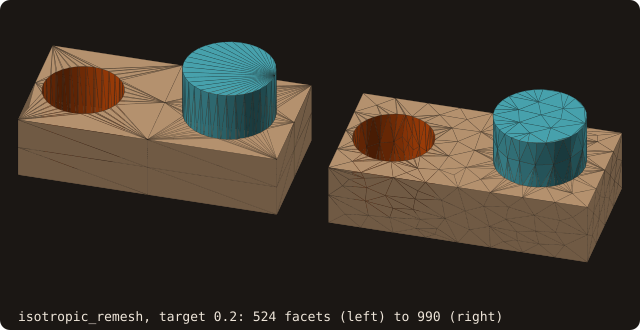
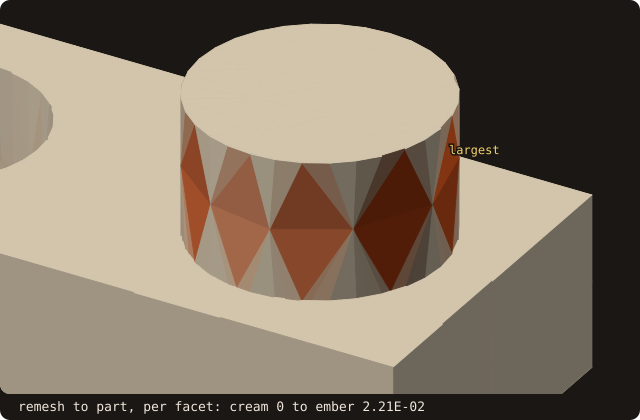
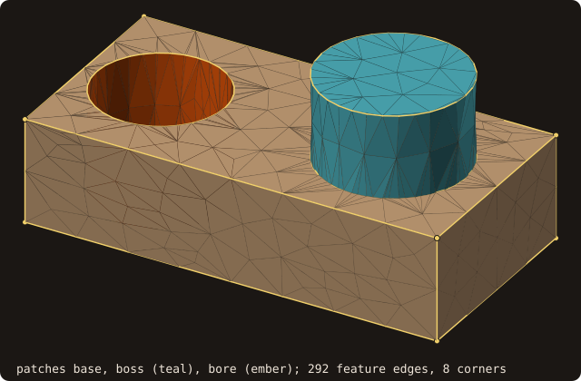
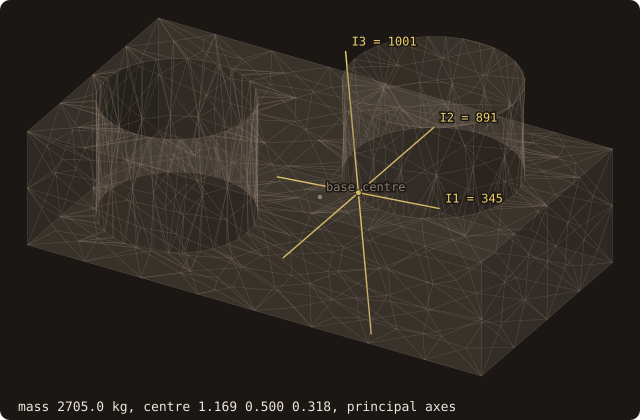

# 12. Geometry processing and analysis

Not every body arrives as a scanned mesh. A machined part is built from primitives, and before it goes to a solver
its surface is remeshed, checked against the design, and measured: which faces carry which boundary condition, where
its walls are thinner than a cell, what it weighs. This chapter does it on a bracket: a base, a round boss on top, a
bore drilled close to one end. Every program builds the part itself from `cube-01.stl`, in six steps, each a short
run that starts where the previous one ended.

{.fossil-figure}

## Building the part

The primitives are closed surfaces. The base is `cube-01.stl` resized to 2 × 1 × 0.5; the boss and the bore are
32-sided prisms built facet by facet.

<<< @/examples/snippets/tut12_a_build-primitives.f90

`box` and `cylinder` are helpers of the program, after its `contains`. The prism:

<<< @/examples/snippets/tut12_a_build-cylinder.f90

- `adopt_facets(facets=)` makes a surface from an array of `facet_object`: it builds the vertex pool, the
  connectivity and the tree, as `load_from_file` does. The caps are fans, outward by the vertex order.
- `set_patch(facets=, name=)` puts the facets in a named patch, created if new. Every facet keeps its patch through
  the operations that follow, so the finished part still knows which face came from which primitive.

The boss goes on with a union:

<<< @/examples/snippets/tut12_a_build-union.f90

- `boolean(other=, op=, status=)` replaces the surface by the union (`BOOL_UNION`), intersection (`BOOL_INTERSECT`),
  difference (`BOOL_DIFFERENCE`) or symmetric difference (`BOOL_SYMDIFF`) with `other`. Both must be closed and
  outward. The patch tables of the two are merged by name.
- The arrangement is exact: cut points are implicit points, every decision is an exact predicate, and there is no
  tolerance to tune. The program checks it against the volume the polygonal solids must have, 1 + A₃₂ · 0.4 with
  A₃₂ = 16 r² sin(2π/32) the area of the 32-gon.

The bore comes out with a difference:

<<< @/examples/snippets/tut12_a_build-difference.f90

<<< @/examples/output/tut12-build.ansi{ansi}

- Each primitive is watertight, and so is each result: 248 facets after the union, 524 after the difference.
- The volumes differ from the exact polygonal volumes by −8.88e-16 and −1.55e-15: round-off of the volume sum, no
  error from the cuts.
- The part carries three patches, base, boss and bore. The figure shows them, and the cut curves in gold: the edges
  where a facet of one patch meets a facet of another, the rims where the boss stands on the base and where the
  bore enters and leaves it.

{.fossil-figure}

## Remeshing

A boolean result is correct but badly shaped: the faces of the base are a few long triangles fanned out to the
rims, and the edges run from 0.0038 to 1.118. A solver wants edges of about one length.

<<< @/examples/snippets/tut12_b_remesh-remesh.f90

- `isotropic_remesh(target_length=, iterations=, preserve_features=, status=)` runs, per iteration, four passes:
  split the edges longer than 4/3 of the target, collapse those shorter than 4/5, flip edges towards valence 6, and
  relax the vertices tangentially, projecting them back onto the input surface. A collapse, flip or move that would
  put a facet more than 0.07 of the target off the input is refused, so a coarse target does not eat the body.
- `preserve_features=.true.` locks the vertices on creases sharper than 30 degrees, so the box edges and the rims
  stay where they are. Patch boundaries are locked too.
- The remesh works on a copy (`mesh = part`): the part stays as the reference for the checks of the next steps.

Then the same remesh towards a longer target, 0.4, on the result:

<<< @/examples/snippets/tut12_b_remesh-coarsen.f90

<<< @/examples/output/tut12-remesh.ansi{ansi}

- The facets grow from 524 to 1158 in four iterations, as the long edges of the base are split, then fall to 990 as
  the short ones collapse: the 32-gons of the boss and the bore have sides of 0.069, below 4/5 of the target (0.16).
  The longest edge falls from 1.118 to 0.3352 over six iterations, still above 4/3 of the target (0.267): the long
  edges of the base need more passes.
- The shortest edge stays at 0.0038: both its ends lie on a rim, locked, and two locked vertices are never merged.
- The remesh towards 0.4 coarsens: 990 facets to 620. (Before [issue #79](https://github.com/szaghi/FOSSIL/issues/79)
  the collapse test rejected almost every interior edge, and the remesh only refined: 2218 facets, then 2218.)

{.fossil-figure}

The figure shows the limit of this remesh: short edges and thin facets remain along the rims and at the corners of
the base, where the vertices are locked and cannot collapse into each other.

## Checking the change

A remeshed surface is a different surface. How far it moved is a number with a guarantee, not an impression.

<<< @/examples/snippets/tut12_c_deviation-deviation.f90

- `deviation(other, lower=, upper=, mean=, rms=, per_vertex=, tolerance=, status=)` brackets the one-sided Hausdorff
  distance h(self, other), the largest distance from a point of self to other. `lower` is the largest distance at
  samples of self (vertices, edge midpoints, facet interiors); `upper` is certified by a branch and bound that splits
  the facets of self until `upper - lower` is below `tolerance` (default 1e-3 of the bounding-box diagonal).
  `per_vertex` is the distance at each vertex, `mean` and `rms` are estimates over the surface.
- The two directions answer two questions: h(mesh, part) is how far the mesh strays from the part, h(part, mesh)
  what of the part the mesh misses (a cut corner, a lost rim). `hausdorff(other)` is the larger of the two.
- Where two surfaces share a plane their facets cross in it, and the branch and bound refines along the crossings at
  a cost of about 1/tolerance. The part and the mesh share every flat face, so the second call takes
  `tolerance=5.e-3_R8P`, which keeps the run short.

<<< @/examples/output/tut12-deviation.ansi{ansi}

- The vertices of the mesh lie on the part, 1.10e-14 at most: the remesh projects them onto it. The facets between
  them stray by at most 1.22e-2 (certified), at least 9.92e-3 (sampled); the mean distance is 3.55e-4.
- The part is at most 1.49e-2 from the mesh, at least 9.87e-3. The walls of the boss and the bore meet at 11.25
  degrees, below the 30-degree threshold, so they are not locked and the remesh coarsens them, but only as far as its
  error bound allows: a collapse, flip or move is refused when a facet it makes would stray more than 0.07 times the
  target, 1.4e-2, from the input (checked at the centroid and edge midpoints of the facet, so a facet can stray a
  little more between them). On the boss (r = 0.35) that allows chords up to about 0.2 across the 32-gon, of sagitta
  r(1 − cos(asin(0.2 / 2r))) = 1.4e-2. A smaller target, or a lower feature angle, keeps the walls closer. (Before
  [issue #91](https://github.com/szaghi/FOSSIL/issues/91) there was no bound: chords of 0.27, 2.78e-2 away.)
- The volume changes by −1.09e-3 of itself.

The figure colours each facet of the mesh by the largest distance to the part at seven points of it. The distance is
zero on the flat faces and largest on the coarsened wall of the boss, where the facets cut chords across the 32-gon;
the largest value, 9.28e-3, is the largest at the seven points.

{.fossil-figure}

## Patches and feature edges

A solver assigns boundary conditions by patch, and a grid generator keeps its lines on the creases.

<<< @/examples/snippets/tut12_d_features-patches.f90

- `get_patches_number()`, `patch_name(i)` and `facet_patch(i)` read the patch table. The table also holds the empty
  patches the inputs were made with (the header of `cube-01.stl`, the unnamed prisms), which the loop skips.
- The ASCII writer saves one `solid <name>` block per non-empty patch, and the point queries return the patch of the
  closest facet (`query_many(patches=)`, [chapter 8](./08-ib-queries)).

<<< @/examples/snippets/tut12_d_features-features.f90

- `feature_edges(edges=, kinds=, corners=, polyline_start=, polyline_vertices=, angle=, status=)` returns the creases
  sharper than `angle` (default 30 degrees; `FEATURE_EDGE_SHARP`), the boundary and non-manifold edges, the corners
  where they meet, and the edges chained into polylines between corners. The polylines are CSR arrays: polyline p has
  the vertices `polyline_vertices(polyline_start(p):polyline_start(p+1)-1)`; a polyline whose first vertex is its last
  is a closed loop.
- Comparing them before and after the remesh is a check the deviation cannot make: a folded facet in a flat face is
  at distance zero from the part, but it adds a crease.

<<< @/examples/output/tut12-features.ansi{ansi}

- The three patches came through both booleans and the remesh: base 606 facets, boss 178, bore 206.
- The part has 260 feature edges, 8 corners and 16 polylines: 12 chains between corners, the edges of the base, and 4
  closed loops without a corner, the top and bottom rims of the boss and of the bore. Their facets meet at 11.25
  degrees, below the threshold, so the rims have no corners.
- The mesh has more feature edges, 292, because the remesh split them, but the same 8 corners and 16 polylines, all
  sharp: no crease was added or lost.

{.fossil-figure}

## Thin walls

The bore is 0.06 from the x = 0 end. On a grid of cells of 0.1, that web falls between cells.

<<< @/examples/snippets/tut12_e_thickness-thickness.f90

- `thickness(thickness=, gap=, method=, invalid=, status=)` gives per facet how thick the body is behind it, and the
  gap to the next wall in front. `THICKNESS_RAY` is the median of a cone of 31 rays (shape diameter);
  `THICKNESS_MEDIAL` the diameter of the largest inscribed ball. `invalid` counts the facets where too few rays
  counted, which flags an open or misoriented surface.
- `thin_regions(thickness=, gap=, h=, factor=, region=, region_area=)` groups the facets thinner than `factor * h`
  into edge-connected regions: `region(i)` is the region of facet i (0 when it is not thin), `region_area(r)` the
  area of region r, largest first. With h the cell size of the grid to come, these are the places where a wall falls
  between cells.

<<< @/examples/output/tut12-thickness.ansi{ansi}

- Both regions are on the web: the end face (10 facets) and the bore wall facing it (29 facets). Their thinnest
  value, 0.0655, is the web of 0.06 seen through the cone: on a plate of thickness t the ray method gives 1.072 t
  (see [Thickness](/guide/advanced/thickness)). No facet is invalid.
- The ray method misreads slivers: the cone of rays from a small facet next to a crease can hit the wall just
  across it. Before [issue #91](https://github.com/szaghi/FOSSIL/issues/91) the remesh left four such facets on the
  top cap of the boss, at its rim, each a region of its own, 0.043 thick; `region_area` sorts such regions last, and a
  solver can drop regions below a cell's area.

{.fossil-figure}

## Mass properties

<<< @/examples/snippets/tut12_f_mass-mass.f90

- `mass_properties(mass=, center=, inertia=, principal_moments=, principal_axes=, density=, about=, status=)` gives
  the exact mass properties of a closed body (`STATUS_INVALID_INPUT` otherwise), as in
  [chapter 11](./11-moving-bodies): the mass, the centre of mass, the inertia tensor about it, and its principal
  moments (ascending) with their axes as columns. With the density of aluminium in SI units, the lengths are metres.

<<< @/examples/output/tut12-mass.ansi{ansi}

- The bracket weighs 2705.05 kg. Its centre of mass is at x = 1.1692, towards the boss and away from the bore (the
  base alone has it at x = 1), at y = 0.4999, on the plane of symmetry to 1e-4 (the remesh is not symmetric), and at
  z = 0.3178, lifted by the boss.
- The principal axes are y (to 1e-3) and two axes in the xz plane tilted by 0.093 rad (5.3 degrees) from x and z:
  the part is symmetric about y = 0.5 only. The smallest moment, 345.495, is about the long axis.
- The mass of the remesh differs from that of the part by −1.09e-3, the volume change of step 3: a uniform density
  scales the volume.

{.fossil-figure}

::: tip What you learned
`boolean` builds a watertight part from closed primitives, exactly; `set_patch` names its faces; `isotropic_remesh`
with `preserve_features` refines and coarsens it towards one edge length; `deviation` certifies how far
the result moved; and `feature_edges`, `thickness` with `thin_regions`, and `mass_properties` measure it.
Reference: [Boolean operations](/guide/advanced/booleans), [Isotropic remeshing](/guide/advanced/isotropic-remesh),
[Surface deviation](/guide/advanced/surface-deviation), [Named patches](/guide/advanced/patches),
[Feature edges](/guide/advanced/feature-edges), [Thickness and gaps](/guide/advanced/thickness),
[Mass properties](/guide/advanced/mass-properties).
:::

Next: [13. Structured blocks and overset grids](./13-blocks-overset).
