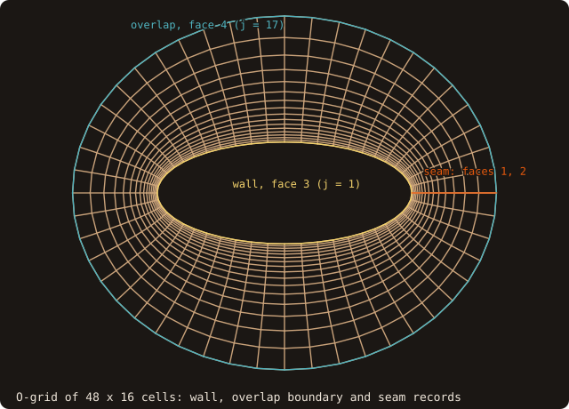
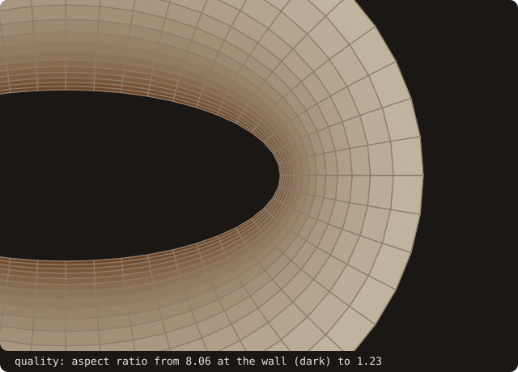
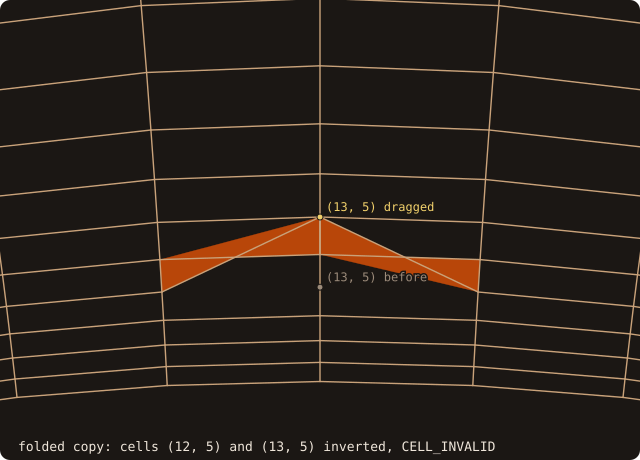
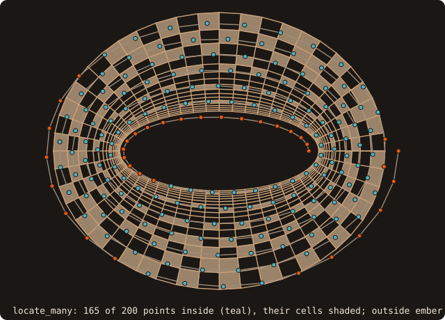
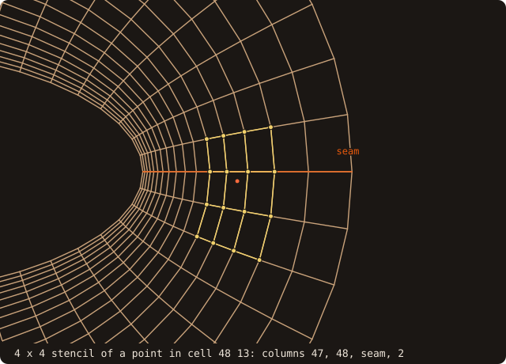
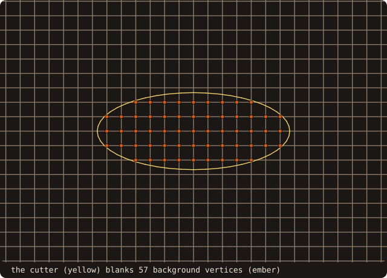
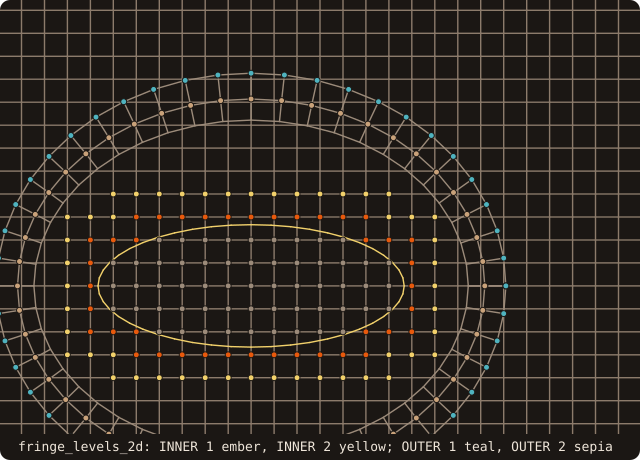

# 13. Structured blocks and overset grids

The chapters so far put a body into a Cartesian grid. A body-fitted solver puts grids around the body instead:
curvilinear structured blocks, overlapping each other and a background. This chapter builds an O-grid around an
elliptic cylinder and checks it, locates points in it and interpolates from it (steps 1 and 2), then assembles it with
a Cartesian background: holes, donors, receptors, fringes and the connectivity file a solver reads (step 3), the
orphans of a too-narrow overlap (step 4), and the assembly of a moving O-grid (step 5). Everything is 2-D; the 3-D
types and routines have the same names without `_2d`.

## An O-grid

<<< @/examples/snippets/tut13_a_block-block.f90

- The O-grid has 49 × 17 vertices on the elliptic coordinates of an ellipse of semi-axes 1 and 0.4: i runs around
  the body, j out of it, with the layers clustered at the wall. The vertices are plain arrays `u(ni, nj)`,
  `v(ni, nj)` (3-D: `x, y, z(ni, nj, nk)`); cell (i, j) is spanned by vertices i..i+1, j..j+1.
- `initialize(u, v, name=)` copies them. The last column repeats the first exactly: the seam.

A block alone knows nothing about its neighbours or its boundaries. Topology records say what each face is:

<<< @/examples/snippets/tut13_a_block-records.f90

- `detect_topology_2d(blocks)` proposes the records of a set of blocks from coincident vertices (exact by default,
  `tolerance=` for grids written with round-off). Here it finds the seam: one `TOPO_ABUT` record on face 1 (−i) and
  one on face 2 (+i), each pointing at the other, with the transform (1, 2): direction i of this side runs along
  direction i of the other. Walks and stencils cross the seam through these records. Periodic records come from
  `translations=`, polar axes as `TOPO_SINGULAR`.
- `add_record` appends records by hand. The physical boundaries are `TOPO_BOUNDARY` records with a name: the wall on
  face 3 (−j) and, on face 4 (+j), the boundary that receives from the background in the assembly. The assembly reads
  the names `wall` and `overlap`.

{.fossil-figure}

## Checking the cells

A solver needs every cell's geometry and a guarantee that no cell is inverted:

<<< @/examples/snippets/tut13_a_block-validity.f90

- `geometry(area=, centroid=, face_i=, face_j=)` gives the exact cell geometry.
- `validity(status)` decides each cell exactly: `CELL_VALID`, `CELL_INVALID`, `CELL_SINGULAR` (a collapsed edge, a
  pole). In 2-D the edges are straight, so the four corner orientations (`orient2d`) decide; in 3-D the trilinear
  Jacobian is certified by its Bernstein coefficients.
- `quality(skewness=, orthogonality=, aspect=, min_jacobian=)` gives per-cell metrics: equiangle skewness,
  orthogonality of the faces to the line between neighbouring centroids, aspect ratio, and the certified minimum
  Jacobian over the mean.

<<< @/examples/output/tut13a.ansi{ansi}

- The two seam records come first; `add_record` brings the block to 4.
- The cells sum to −5.992: the sign is the block's handedness (i runs counter-clockwise, j outward, so the block is
  left-handed), not a defect. Its size is that of the polygon, 0.3 % below the area between the two ellipses, 6.010.
- All 768 cells are valid. The skewness is at most 0.103 and the orthogonality at least 0.986, since elliptic
  coordinates are orthogonal; the aspect ratio goes from 8.06 in the flat cells at the wall to 1.23 outside.
- The folded copy drags vertex (13, 5) two layers out, past the vertices of the layer above it: the two cells above
  it, (12, 5) and (13, 5), turn inside out and `validity` flags them; the two below are stretched but stay valid.

{.fossil-figure}

{.fossil-figure}

## Locating points

Interpolation from the block starts by finding the cell that holds each point:

<<< @/examples/snippets/tut13_b_locate-locate.f90

- `build_search` stores the cell validity and the handedness and builds a bounding-box tree over the cells.
- `locate_many(pu, pv, cell, xi, status)` returns per point the cell (i, j), the local coordinates ξ in [0, 1]² and a
  status: `LOC_INSIDE`, `LOC_OUTSIDE`, or, when only a cell that is not valid contains the point, `LOC_WARPED` or
  `LOC_DEGENERATE`. Containment is exact in 2-D; a point on a face shared by two cells belongs to the low one.
- `walk=.true.` jumps from the previous point's cell towards the point (stencil jumping): cheap when consecutive
  points are close, as the vertices of a grid line are. It hands the point to the tree when it cannot settle it, for
  instance when the walk reaches the wall or the outer boundary; `jumps=` counts the cells crossed, `fallbacks=` the
  points handed over. The result equals the robust one bit for bit.

{.fossil-figure}

## Interpolating with stencils

<<< @/examples/snippets/tut13_b_locate-stencils.f90

- `stencils(cell, xi, q, nodes, weights, status)` builds a q × q Lagrange stencil on the vertices around each located
  point: `nodes(:, k, n)` are vertex indices, `weights(k, n)` their weights. Near the wall and the outer boundary it is
  shifted one-sided (`STENCIL_SHIFTED`); across the seam it takes the vertices of the other side through the records.
- For q > 2, ξ is recomputed on the isoparametric map of degree q − 1 of the stencil's own vertices
  (`order_matched=`, on by default): the bilinear ξ alone would cap the interpolation at second order.

<<< @/examples/output/tut13b.ansi{ansi}

- 165 of the 200 points are inside the block. Point 100 lies in cell (24, 14) at ξ = (0.275, 0.164).
- The walk returns the same cells and ξ bit for bit; it crosses 314 cells and hands 38 points to the tree, those
  whose walk ends at the wall or the outer boundary.
- The interpolation error of sin(2x) cos(y) falls from 9.78e-3 at q = 2 to 1.75e-3 at q = 3 and 8.53e-4 at q = 4.
  Fewer stencils are centred as q grows (165, 149, 133): the others are shifted at the wall or the outer boundary.

{.fossil-figure}

## Cutting holes

The O-grid now overlaps a Cartesian background of 41 × 33 vertices at spacing 0.15. The background covers the body
too: its vertices inside the body must be blanked.

<<< @/examples/snippets/tut13_c_assembly-background.f90

<<< @/examples/snippets/tut13_c_assembly-holes.f90

- `wall_cutter_2d(blocks, cutter)` builds the cutter, a `curve_object`, from the edges of the faces recorded as
  `wall`, oriented with the solid on the left. Several walls make several loops; overlapping wall patches are
  trimmed.
- `hole_flags_2d(blocks, cutter, holes, cuts=)` flags the vertices inside the cutter by its fast winding number:
  exact on a closed wall. `cuts=` says which blocks the cutter cuts: the background, not the O-grid, whose wall lies
  on the cutter. `offset=` blanks below that signed distance instead of 0, a band off the wall.
- `hole_map_2d(blocks, cutter, holes, n)` is the alternative of the founding codes: a Cartesian map of n(1) × n(2)
  elements over the cutter, the elements the wall meets found exactly and the others painted outside from the
  corners. A vertex in an uncut element takes its status; one in a cut element looks along a grid axis to the first
  uncut element and counts the exact wall crossings in between. Here it blanks the same vertices. `xray_flags_2d` is
  the X-ray variant, exact only on its rays.

{.fossil-figure}

## Donors and receptors

The vertices next to the holes and on the O-grid's outer boundary have no equation of their own: they receive values
interpolated from the other grid.

<<< @/examples/snippets/tut13_c_assembly-classify.f90

- `donor_candidates_2d(blocks, donors)` locates every vertex of every block in every other block and keeps all
  candidates, each with its donor cell, ξ, the donor and receptor cell sizes and the certified minimum Jacobian of the
  donor.
- `classify_2d(blocks, donors, masks, SELECT_EXPLICIT, q, holes=)` gives the mask per vertex: `iota` = 1 for a field
  point, 0 for a hole, −k for a receptor from block k; `donor` is its chosen candidate. With the explicit rule the ring
  around the holes and the vertices of the `overlap` faces must receive; a candidate is valid when its q × q donor
  stencil holds no hole and no receptor, and candidates are tried by increasing donor size. Validity depends on the
  neighbours, so the classification is iterated to a fixed point; `circular=` counts receptor pairs in each other's
  stencils. `SELECT_IMPLICIT` chooses by donor cell size instead: a vertex receives when a smaller donor cell exists.

{.fossil-figure}

## Fringes and connectivity

<<< @/examples/snippets/tut13_c_assembly-fringes.f90

- `fringe_levels_2d` sets `masks(b)%fringe`: INNER 1 and 2 around the holes, OUTER 1 and 2 at the overlap
  boundary, the levels a solver with a wider stencil needs.
- `overlap_width_2d` is Chesshire's width, the least distance between the receptors of the two blocks.
- `build_connectivity(masks, donors, q, 2, conn)` makes the receptor list and `save_connectivity(conn, file)` writes
  it as text: per block the counts by class, then one line per receptor with its block and vertex, the donor block,
  the donor cell, ξ, the stencil width, a low-order flag and the donor-to-receptor size ratio.

<<< @/examples/output/tut13c.ansi{ansi}

- The cutter has 48 vertices, one per wall edge; it blanks 57 background vertices, and the hole map agrees.
- The 40 background vertices around the holes receive from the O-grid and the 49 vertices of the O-grid's outer
  boundary from the background. No orphan, two iterations of the fixed point, no circular pair; the overlap width is
  0.540.
- The connectivity file lists the 89 receptors; the first is the outer vertex 785 of the O-grid, (1, 17), in
  background cell (32, 16) at ξ = (0.097, 1.0): on that cell's top edge, which the low-side rule gives to the lower
  cell.

{.fossil-figure}

## Orphans

The overlap has to be wide enough for the stencils. The same assembly with the O-grid cut to fewer layers:

<<< @/examples/snippets/tut13_d_orphans-orphans.f90

- A receptor without a valid donor is an orphan; `masks(b)%orphan` gives the cause: `ORPHAN_STENCIL_HOLE` (every
  candidate stencil touches a hole), `ORPHAN_RECEPTOR_DONOR` (it holds a receptor, explicit interpolation),
  `ORPHAN_NO_CANDIDATE` (no donor cell at all), `ORPHAN_BOUNDARY`, `ORPHAN_WALL`.

<<< @/examples/output/tut13d.ansi{ansi}

- With 15 layers all 49 outer vertices find a donor; with 13 layers 8 are orphans, with 11 layers 31, with 9 all of
  them. The O-grid is thinnest at the ends of the long axis, and the orphans start there: their stencils reach the
  receptors around the holes, or the holes themselves. A solver cannot interpolate there; the grid has to change.

{.fossil-figure}

## A moving near-body grid

When the body moves, its O-grid moves with it and the assembly is redone at every step. The O-grid does not need to
be rewritten: it stays in its body frame, with its search tree and its cutter built once, and the kernels take its
pose.

<<< @/examples/snippets/tut13_e_moving-moving.f90

- `poses=` on `hole_flags_2d` and `donor_candidates_2d` gives each block's pose (a `rigid_pose_2d_t`,
  [chapter 11](./11-moving-bodies)); `cutter_pose=` the cutter's. The background takes the identity.
- `exposed_points(old, new, exposed, violations)` compares two classifications: `exposed` flags the vertices that were
  holes or receptors and are now field points; they need values before the solver advances them. `violations`
  counts the holes that became field points directly, without receiving first (Meakin & Suhs): the step was too long
  for the fringe.

<<< @/examples/snippets/tut13_e_moving-finer.f90

<<< @/examples/output/tut13e.ansi{ansi}

- Over one period of 12 steps (pitch ±30 degrees, heave ±0.3) the holes go from 57 to 53 and back, the background
  receptors from 40 to 44; no orphan at any pose. After the first step, 9 to 16 background vertices are exposed per
  step.
- At steps 4 and 10, the first steps back from the extreme pitch, one hole becomes a field point directly: the step
  is too long for the fringe there. With 24 steps per period no hole does.

{.fossil-figure}

::: tip What you learned
A `curvilinear_block_2d_t` with its topology records (`detect_topology_2d`, `add_record`), exact cell geometry,
validity and quality, located points (`build_search`, `locate_many`, `walk=`) and Lagrange stencils (`stencils`). An
overset assembly from kernels: `wall_cutter_2d`, `hole_flags_2d` (or `hole_map_2d`), `donor_candidates_2d`,
`classify_2d`, `fringe_levels_2d`, orphans by cause, `build_connectivity` and `save_connectivity`; a moving block by
`poses=`, and `exposed_points` between two steps. Reference: [Curvilinear blocks](/guide/advanced/curvilinear-blocks),
[Overset assembly](/guide/advanced/overset).
:::

Next: [14. Contact: distance and collision](./14-contact).
