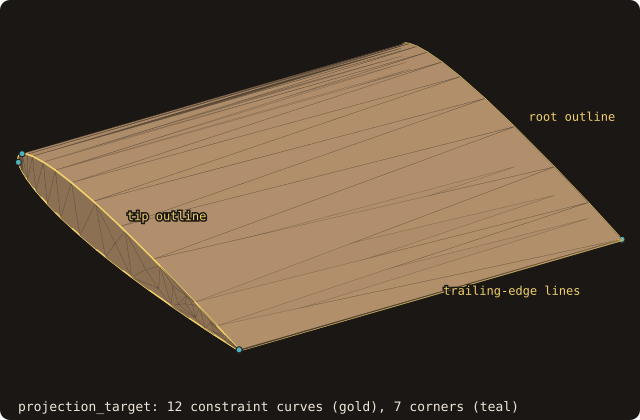

# 15. Body-fitted grids

A body-fitted grid has its first grid line on the wall. FOSSIL does not generate such grids, but it supplies the
geometry their generators and solvers need: points put on the body without crossing its edges, a 2-D hyperbolic
O-grid marched out of a section, and a report of the wall spacing against a y₁⁺ target. The body of this chapter is
the NACA0012 wing `naca0012-ascii.stl` (chord x ∈ [-0.25, 0.75], span z ∈ [0, 1], a blunt trailing edge 0.0025
thick). Its trailing edge is where an unconstrained projection goes wrong. The chapter takes four steps, one program
each: the projection target, a block face projected onto the wing, an O-grid around its section, and the report on
that O-grid.

## The projection target

Every projection reads one structure, built once from the surface.

<<< @/examples/snippets/tut15_1_target-target.f90

- `projection_target(target)` groups the triangles by named patch, with one tree per patch, and extracts the
  **constraint curves** and the **corners**. The curves are the feature edges of the surface (sharp, boundary,
  non-manifold; `angle=` sets the dihedral threshold, 30 degrees by default) plus the boundaries between patches,
  chained from corner to corner. A corner is a vertex where the constraint edges meet in a number other than two, or
  where a curve turns by more than `corner_angle` (30 degrees).
- The wing has one patch, 12 constraint curves made of 97 segments, and 7 corners (the run is in the next section).
  The curves are the root and tip outlines, the two trailing-edge lines and the edges of the blunt base. The corners
  are the four ends of the trailing-edge lines and three points of the root and tip outlines near the leading edge,
  where a polyline turns by more than 30 degrees.

{.fossil-figure}

## Free and constrained projection

Six points around the trailing edge at mid-span are put on the wing in two ways.

<<< @/examples/snippets/tut15_1_target-points.f90

- `classify_points(target, x, y, z, tolerance, kinds, ids)` gives each point its constraint: `PROJ_CORNER` if a
  corner is within the tolerance, else `PROJ_CURVE` if a constraint curve is, else `PROJ_PATCH` with the patch of the
  closest facet. `ids` is the corner, curve or patch.
- `project_points(target, x, y, z, kinds, ids, fx, fy, fz, distances=, status=)` moves each point to the closest point of its
  target: the whole surface (`PROJ_FREE`), one patch, one constraint curve (or any, id 0), one corner. Ties go to
  the lowest facet or segment index, so the result does not depend on the trees.

<<< @/examples/output/tut15-target.ansi{ansi}

- Points 1 and 5 are farther than 0.01 from every curve: they take the patch, and both projections agree. Point 5
  lies behind the base and lands on it.
- Points 2, 3, 4 are within 0.01 of curve 6, the upper trailing-edge line, and point 6 of curve 3, the lower one.
  Free, point 2 lands on the upper surface at x = 0.7493, ahead of the edge, and point 3 on the base at y = 0.0002;
  constrained, both land on the edge itself, (0.75, 0.00126). A grid line meant to run along the edge would
  zig-zag across it with the free feet.

{.fossil-figure}

## Projecting a block face

A block of chapter 13 whose face k = 1 lies over the upper side: 41 chordwise vertices, cosine-clustered towards
the leading and trailing edges, by 21 spanwise. The face is projected twice, from two distances with two tolerances.

<<< @/examples/snippets/tut15_2_face-face.f90

- `project_block_face(block, face, target, tolerance, moved=, kinds=, status=)` classifies and projects every
  vertex of one face of a `curvilinear_block_t`, in place. The faces are numbered 1-6 = -i, +i, -j, +j, -k, +k:
  face 5 is k = 1. `moved` is the distance each vertex moved and `kinds` the constraint it took. The other layers
  are not touched. In 2-D, `project_block_side(block, side, target, tolerance, ...)` does the same for one side of a
  `curvilinear_block_2d_t`, with `classify_points_2d` and `project_points_2d` behind it.

<<< @/examples/output/tut15-face.ansi{ansi}

- The tolerance is a radius: every vertex within it of a curve goes onto the curve. With the face 0.005 off the
  wing it must exceed 0.005, or the trailing-edge row would take the patch and land beside the edge. But the last
  two chordwise steps are 0.00461 and 0.00154: with tolerance 0.01 the vertices i = 39 and 40 are within it of the
  trailing-edge line too, and all three go onto it. The trailing-edge row is on x = 0.75, as asked, and 42 face
  edges have zero length, two per spanwise station: degenerate cells.
- The tolerance has to exceed the distance from the face to the body and stay below the grid spacing next to the
  edges. With the face 0.0005 off the wing the largest move is 0.0012, below the tolerance 0.0014, which is below
  the last step 0.00154. The edge rows land on their curves (2 corners, 99 vertices on curves) and no edge
  collapses.

{.fossil-figure}

## A hyperbolic O-grid

A 2-D grid around the mid-span section, with its first height set by a y₁⁺ target.

<<< @/examples/snippets/tut15_3_ogrid-ogrid.f90

- `slice_surface` (chapter 7) gives the mid-span section, 60 vertices, counter-clockwise. Splitting each segment in
  two keeps the polygon and doubles the wall points to 120.
- The first height comes from the y₁⁺ target: y₁ = y₁⁺ ν / u_τ. `utau_flat_plate(u_inf, nu, x)` estimates u_τ for a
  turbulent flat plate, C_f = 0.0576 Re_x^(−1/5), u_τ = U sqrt(C_f / 2). At Re = 10⁶ and mid-chord it gives
  u_τ = 4.569e-2, so h₁ = 2.189e-5 for y₁⁺ = 1.
- `geometric_spacing(h1, ratio, layers)` returns the layer heights h₁ qᵏ⁻¹: 40 layers with ratio 1.2 reach 0.1607
  from the wall, the last one 2.681e-2 high.
- `hyperbolic_grid_2d(u, v, spacing, block, closed=, epsilon=, invalid=, status=)` marches the layers outward from a
  closed curve (counter-clockwise; `closed=.false.` for an open one). Each step is normal to the current layer, with
  the mitre length h / cos(β/2) at a point where the layer turns by β, so a layer stays at height h from both sides
  of a corner. The step directions are smoothed implicitly, more in the outer layers (`epsilon`, 0.5 at most by
  default). The result is a `curvilinear_block_2d_t` of 121 × 41 vertices (the first point repeated at i = 121).
  Every cell is checked by the certified Jacobian of the [curvilinear blocks](/guide/advanced/curvilinear-blocks):
  `status = 2` with `invalid > 0` reports a fold.

<<< @/examples/snippets/tut15_3_ogrid-steps.f90

<<< @/examples/output/tut15-ogrid.ansi{ansi}

- No cell fails the certified validity. The heights grow by 1.2 per layer: 1.129e-4 at layer 10, 4.330e-3 at layer
  30. The first 20 layers fill only 4.086e-3, the last 10 more than 0.13.

{.fossil-figure}

{.fossil-figure}

## The wall-spacing report

The last program rebuilds the O-grid of step 3 and checks what it delivers.

<<< @/examples/snippets/tut15_4_report-report.f90

- The report reads the wall from the block's topology records (chapter 13): every `TOPO_BOUNDARY` record named
  `wall`, here the side j = 1. `wall_cutter_2d(blocks, curve)` turns those sides into a curve, the true wall.
- `block_report_2d(block, cutter, nu, report, ...)` (`block_report` for a 3-D block and a surface cutter) measures
  per wall point `y1_line`, the first step along the wall-normal grid line, and `y1_wall`, the distance of the first
  off-wall point to the cutter: the true height, smaller when the grid line leaves the wall at an angle. Then
  `y1p` = y1_wall u_τ / ν, `growth`, the largest ratio of consecutive steps along the grid line, and over the block
  the cell quality of chapter 13: skewness, orthogonality, aspect, certified validity.
- u_τ is given here, `u_tau=` for all points (`u_tau_wall=` per point), the value the first height was designed
  with.

<<< @/examples/snippets/tut15_4_report-estimate.f90

- Without a solver's u_τ, `u_inf=` and the leading edge `x_le=` make the report estimate it at each wall point by
  the flat-plate correlation, with x − x_le as the distance (`utau_estimated` is then true).

<<< @/examples/snippets/tut15_4_report-save.f90

- `save_block_report(report, file_name)` writes the totals (`#` lines) and one line per wall point: indices, face,
  y1_line, y1_wall, y1+, growth.

<<< @/examples/output/tut15-report.ansi{ansi}

- With the u_τ it was designed for, y₁⁺ has minimum 0.9999 and mean 1.0065: the O-grid delivers its target. The
  maximum, 1.3303, is at a corner of the blunt trailing edge, (0.75, -0.00126), where the first step is 2.912e-5
  instead of 2.189e-5: the mitre step keeps the first point h₁ from both sides of the corner, so h₁ / cos(β/2)
  from the corner vertex itself. `above` counts every point with y₁⁺ > 1, round-off excess included: 0.752.
- The growth ratio stays at 1.2 (1.2031 at most), and no cell fails the certified validity. Skewness reaches 0.9029
  and orthogonality falls to 0.0193 at the wall cells beside the trailing-edge corners, where the fan turns cells
  2e-5 high: 4 of the 4800 cells are below 0.5.
- With the flat-plate estimate y₁⁺ is 0 at the leading edge, where x − x_le = 0 and the estimate gives u_τ = 0, and
  2.0163 just behind it, at x = -0.24955, where Re_x is small and the estimate large. It crosses the designed
  value at x = 0.25, where x − x_le = 0.5 is the distance the design u_τ was taken at, and falls below it behind. Such estimates can be about
  300 % off near a leading edge: use them to size a grid before a run, then pass the solver's own u_τ
  (`u_tau_wall=`) to check it after.

{.fossil-figure}

::: tip What you learned
`projection_target` once, then `classify_points` / `project_points` or `project_block_face` to put grid points on a
body without crossing its edges, with a tolerance above the distance to the body and below the spacing at the
edges; `geometric_spacing` from a y₁⁺ target and `hyperbolic_grid_2d` for an O-grid; `block_report_2d` /
`block_report` and `save_block_report` to check the wall spacing and the cells. Reference:
[Body-fitted grid support](/guide/advanced/body-fitted), [Curvilinear blocks](/guide/advanced/curvilinear-blocks).
:::

Next: [16. On the GPU](./16-gpu).
