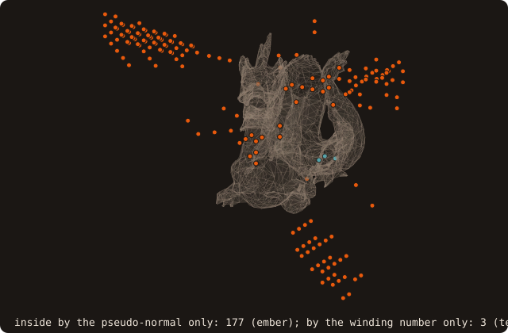
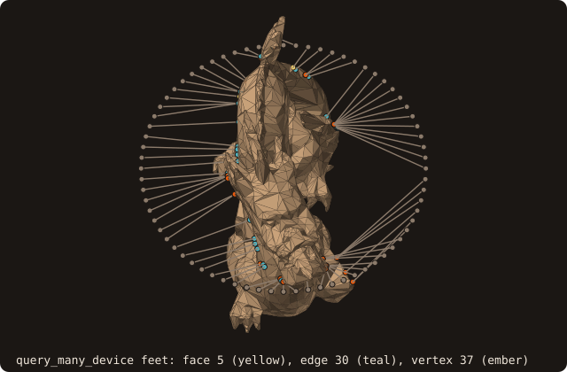
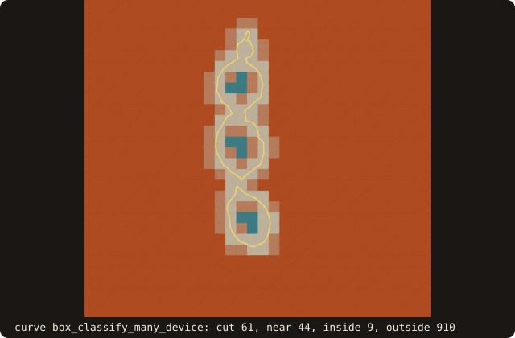

# 16. On the GPU

A large grid asks for millions of distances per regrid. This chapter runs the queries of the earlier chapters on the
device with OpenACC, one batch per call, and checks every result against the host routine it replaces: the distance
batch of chapter 5, the immersed-boundary queries of chapter 8, the box classification of chapter 9 and the 2-D
section of chapter 7.

The pages are built with gfortran. Without an OpenACC compiler the `!$acc` directives are comments, so every
"device" batch below runs on the host, through the same kernels the GPU runs. The runs therefore show the API and the
bit-exactness check, never a speed-up; the same programs built with nvfortran run on the GPU (last section).

## One batch of distances

The surface goes to the device once, then each batch moves only its points in and its distances out.

<<< @/examples/snippets/tut16_a_batch-resident.f90

- `enter_device` copies the flat arrays the device kernels read: the BVH nodes, the triangle payload, the
  pseudo-normals, the winding-number cache, the bodies and the exact facet vertices (plus the feature-edge and thin
  trees of chapter 12 if they were built). A second call is a no-op; `is_on_device` tells whether the copy exists.
- The surface must be analyzed with the SAH BVH, the default tree of `load_from_file`.

<<< @/examples/snippets/tut16_a_batch-batch.f90

- `distance_many_device` has the arguments and the defaults of `distance_many`: unsigned and squared unless
  `is_signed=.true.` and `is_square_root=.true.` are passed. The 24³ points are a lattice over [-0.6, 0.6]³, stored
  x fastest, so the plane k = const is a contiguous slice of the array.
- Each sign algorithm runs once on the device and once on the host, and the program counts the distances that differ
  in any bit.

{.fossil-figure}

The figure is one plane of that batch: the distance field around the dragon's section, the device code path
executed on the host.

## One slice at a time, or one batch

A solver that fills its grid plane by plane can call the host routine once per plane; on the device the whole grid
goes in one call, to keep the GPU busy and pay the transfer latency once. The results must not depend on the split.

<<< @/examples/snippets/tut16_a_batch-slices.f90

- Each point is an independent query: its traversal of the tree and its sign test do not read the other points of
  the batch, so splitting the batch into slices cannot change a bit. The run checks it: 24 host calls of one slice
  each against one device call of 13824 points, 0 mismatches.

{.fossil-figure}

## Two signs, and what the device refuses

The device runs two of the four sign algorithms of chapter 4, and only on the BVH. Anything else is refused, loudly,
instead of silently falling back to the host.

<<< @/examples/snippets/tut16_a_batch-refused.f90

<<< @/examples/output/tut16a.ansi{ansi}

- `SIGN_PSEUDO_NORMAL` (the default) and `SIGN_FAST_WINDING_NUMBER` run on the device, both bit-identical to the host:
  0 mismatches of 13824 each. The FWN branch calls the same `bvh_winding_number_oac` routine with the same constants
  as the host path, which is what keeps it bit-exact.
- `SIGN_RAY_INTERSECTIONS` and `SIGN_SOLID_ANGLE` need a ray traversal or an O(N) sum that is not ported: the call
  returns `status /= STATUS_OK` and writes the reason on stderr (the first `refused` line of the run).
- An octree (`aabb_tree_kind=AABB_TREE_OCTREE`) stays on the host: `enter_device` writes a message and
  `is_on_device` stays false. The device scope is the SAH BVH only.
- `exit_device` releases the device copies. `destroy` does not: call it before the surface is destroyed or goes out
  of scope, and before `analyze` or anything else that rebuilds the tree. `move` (chapter 11) refreshes the device
  copy itself.
- The two signs agree on |d| everywhere and disagree on the sign at 180 of the 13824 points. The repaired dragon is
  not closed (chapter 2). The pseudo-normal decides from the closest feature alone and assumes a closed, outward
  oriented surface; the winding number integrates the whole surface and tolerates holes (chapter 4). The figure shows
  where they differ.

{.fossil-figure}

For a surface that is not closed, pass `sign_algorithm=SIGN_FAST_WINDING_NUMBER` on the device as on the host.

## Rich queries on the device

The immersed-boundary queries of chapter 8 have device twins with the same arguments.

<<< @/examples/snippets/tut16_b_queries-rich.f90

- `query_many_device` returns what `query_many` returns: distance, closest point, closest facet, the feature the foot
  lies on (`FEATURE_FACE`, `FEATURE_EDGE`, `FEATURE_VERTEX`), the pseudo-normal and the body. The kernel computes
  every output and copies out the requested ones. The CPU-only extras (`ambiguous`, `second_foot_points`,
  `curvatures`) have no device twin.

<<< @/examples/snippets/tut16_b_queries-wall.f90

- `wall_distance_many_device(points, distances, bodies, cutoff=)` is the unsigned wall distance of chapter 8 with an
  early cutoff: the traversal starts at cutoff², so a probe with no wall closer gets `cutoff` and body 0.

<<< @/examples/snippets/tut16_b_queries-posed.f90

- `pose=` (chapter 11) maps the points into the body frame on the host and queries the tree as entered: a moving
  body needs no new `enter_device` per step.

<<< @/examples/output/tut16b.ansi{ansi}

Every output matches the host bit for bit on the 12³ probes. Most feet fall on a vertex (1123) or an edge (477), not
inside a face (128): seen from probes spread over the box, the closest point of a coarse mesh is most often one of
its corners or edges.

{.fossil-figure}

## Boxes and curves

AMR tagging (chapter 9) classifies boxes, and the 2-D section (chapter 7) has its own segment tree: both have device
batches.

<<< @/examples/snippets/tut16_c_boxes-boxes.f90

- `box_classify_many_device(lo=, hi=, codes=, radius=)` gives the codes of `box_classify_many`: `BOX_CUT`, `BOX_NEAR`,
  `BOX_INSIDE`, `BOX_OUTSIDE`. The contact test is the same `bvh_box_contact_oac` kernel on both sides; the centre
  sign of a box not cut uses the winding number by default.
- On 16³ boxes of side 0.075 with a near radius 0.05, every box that reaches into the dragon is cut or near, so none
  is inside.

<<< @/examples/snippets/tut16_c_boxes-curve.f90

- A `curve_object` has its own `enter_device`, `exit_device`, `distance_many_device` (points as `(2, n)` arrays,
  signed by default, negative inside), `query_many_device` and `box_classify_many_device`, with the same rules.
- `swept_cells_3d_device` / `swept_cells_2d_device` give the swept geometry of a step on the device, bit for bit
  that of `swept_cells_3d` / `swept_cells_2d`. In 3-D the faces are batched over all the sections of a step:
  1.7-4.7x on an RTX 4070 at 32³-64³. In 2-D only the end poses move, so there is no gain today (the
  [moving bodies reference](/guide/advanced/moving-bodies#on-the-device) has the table). With `map=` they also return
  the piece map of the step, bit for bit the host's; its plan (events, poses) stays on the host
  ([the map on the device](/guide/advanced/moving-bodies#the-map-on-the-device)).
- The piece links of the cut cells run on the device too: `cut_cells_3d_device(..., links=)` and
  `cut_links_2d_device(cut, links)`, bit for bit the host's. On an RTX 4070, cut + links is 6.6-9.4x the CPU at 128³
  and 10.5-12x at 1024² with everything resident (the
  [cut-solver reference](/guide/advanced/cut-solver#on-the-device) has the table).
- `cut_cells_3d_device(surface, x, y, z, cut)` computes the 3-D cut cells of a block on the device (with `links=`
  also their piece links; no moments or quadrature), bit for bit those of `cut_cells_3d`, copied back or with `resident=.true.` left on the device.
  On an RTX 4070 at 128³ cells: 2.1-3.0x the CPU copied back, 2.7-3.8x resident (the
  [cut cells reference](/guide/advanced/cut-cells#on-the-device) has the table and what bounds it).
- `curve%cut_cells_device(x, y, cut)` computes the 2-D cut cells of a block on the device, bit for bit those of
  `cut_cells` (moments, boundaries and quadrature stay on the host). With `resident=.true.` the outputs stay on the
  device for device code (`cut%update_host` brings them back, `cut%exit_device` releases them). On an RTX 4070 at
  1024² cells: 1.4-2.1x the CPU with the outputs copied back, 6-7x resident; a moving body (move, tag, cut per step)
  gains 1.8-2.3x and 3.6-4.3x. The tables are in the
  [cut cells reference](/guide/advanced/cut-cells#on-the-device).
- A whole time step of a moving body runs on the device too: move, tag, cut + links, swept. Each stage is bit for
  bit the CPU's. On an RTX 4070 a 3-D step gains 1.8-3.9x at 32³, 5.4-5.9x at 64³ and 6.6-9.3x at 128³. The swept
  geometry and, on dense meshes, the tags take most of the device step. A 2-D step gains nothing (0.84-1.01x):
  its swept faces are host work. The table is in the
  [GPU reference](/guide/advanced/device-distance#a-moving-body-time-step).

<<< @/examples/output/tut16c.ansi{ansi}

{.fossil-figure}

## Building for a GPU

On a GPU, build FOSSIL with nvfortran 26.9 or later (NVIDIA HPC SDK). The `static-nvidia` mode builds the library,
`tests-nvidia` the distance benchmark; the `local_nvf` varset sets the compute capability (`cc89` by default, edit
`$NVF_CC` for another GPU, e.g. `cc80` for an A100):

```bash
fobis build --mode static-nvidia --varset local_nvf
fobis build --mode tests-nvidia --varset local_nvf
nvfortran -acc -gpu=cc89,nofma -Mnofma -I static/mod docs/examples/src/tut16_a_batch.f90 static/libfossil.a -o tut16_a_batch
```

The flags `-gpu=nofma -Mnofma` turn off fused multiply-add contraction on the device and on the host. FMA contraction
differs between the two, and with it the device results are no longer bit-identical to the host ones (1-ulp
distances, sign and facet flips at near-ties). The figure programs of this chapter also need
`docs/examples/lib/fossil_fig.f90` compiled in.

::: tip What you learned
`enter_device` once, a `*_device` batch per call with the arguments of its host twin, `exit_device` before the tree
changes or the surface goes away. Two signs (pseudo-normal, fast winding number) and the SAH BVH only; anything else
is refused with a status. A batch gives the same bits as any split of it, and built with gfortran the same calls run
on the host with identical results. Reference: [GPU queries](/guide/advanced/device-distance).
:::

This is the end of the tutorial. The [guide](/guide/) and the [reference](/guide/api/) cover every method and argument.
